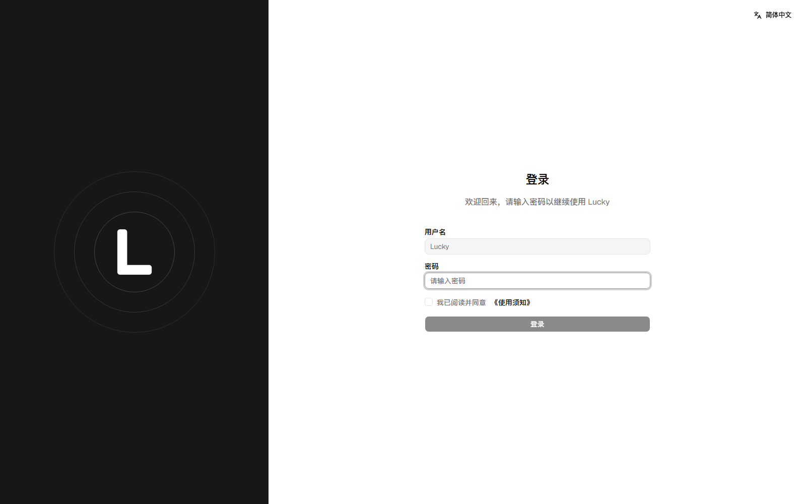

<div align="center">

# Lucky

**any 出品的 LLM 多智能体自主安全测试平台**

[](LICENSE)
[](#一键部署)
[](#docker)

把「信息收集 → 漏洞验证 → 利用链推进 → 报告交付」串成自动闭环：
规划者派意图、执行者跑真实工具、所有动作留痕可回溯，任何时候都能人工接管。

</div>

---

## 一键部署

> 图形化部署页（点按钮即可）：**<https://001ship.github.io/lucky/>**
>
> [](https://render.com/deploy?repo=https://github.com/001ship/lucky)

**Render（最快，自动创建 Web + PostgreSQL）**

点上面的 Deploy to Render 按钮，Render 会读取仓库里的 `render.yaml`，建好服务与数据库并注入 `ARTEX_PG_DSN`。
免费额度够试用；正式用建议 `starter` 及以上。

**Linux / macOS（Docker）**

```bash
curl -fsSL https://raw.githubusercontent.com/001ship/lucky/main/install.sh | sh
```

**Windows（PowerShell，Docker Desktop）**

```powershell
irm https://raw.githubusercontent.com/001ship/lucky/main/install.ps1 | iex
```

**Windows（原生，已有 PostgreSQL）**

```powershell
.\install.ps1 -Native -PgHost 127.0.0.1 -PgPort 5432 -PgUser artex -PgPassword '你的密码'
```

装好后打开 <http://127.0.0.1:8787>，首次进入 `/setup` 用容器日志里的 **Setup token** 设置管理员密码；
登录账号名固定为 **Lucky**。

### Docker

```bash
docker pull ghcr.io/001ship/lucky:latest
docker run -d --name lucky -p 8787:8787 \
  -e ARTEX_PG_DSN='postgres://artex:pass@你的PG:5432/artex?sslmode=disable' \
  -v lucky-data:/app/data \
  ghcr.io/001ship/lucky:latest
```

### 手动下载

到 [Releases](../../releases) 下载对应平台 zip，解压后：Windows 双击 `start.bat`，Linux/macOS 执行 `./start.sh`。
包内 `config.example.json` 填数据库连接即为 `config.json`。

## 核心能力

| 模块 | 说明 |
|---|---|
| **双图态势** | 资产图（跨任务共享真值库）+ 探索图（单任务血缘推进链），互为锚点，可反查「某资产被哪些意图测过」 |
| **多智能体编排** | planner 持有跨轮次共享 todolist，按依赖逐步派发，多步利用链不重复、不错序 |
| **人在环路** | 对话页随时下达指令；审批门对高危工具调用逐条放行/拦截 |
| **流量证据** | 内置记录型 MITM 代理，每条发现可回溯原始报文，支持 Burp 式重放与批量重发 |
| **漏洞复测** | 独立 retester 智能体，三态结论自动回写漏洞状态 |
| **报告交付** | 任务/跨任务报告、按严重度归并的漏洞文件夹、CSV 导出 |
| **MCP 服务端** | 外部智能体经 MCP 连接本平台：查/建/暂停任务，令牌带 scope 与来源白名单 |
| **多模型** | Worker 池按 LLM 配置分配并发，兼容 OpenAI 兼容端点、Anthropic、本地 Ollama |
| **成本止损** | Token 用量按模型统计；无成果止损按运行时长与独立漏洞数自动收尾 |

## 界面

中性灰白主题 + 近黑主色 `#171717` + 1px 细边框 + 0.5rem 圆角，浅/深色一键切换；中英双语。



> 截图目录 `docs/screenshots/` 可自行替换为你的环境截图。

## 从源码构建

```bash
# 前端
cd web && npm ci && NEXT_EXPORT=1 npm run build:static && cd ..
# 二进制（前端内嵌进单文件）
mkdir -p server/webui/dist && cp -r web/out/. server/webui/dist/
CGO_ENABLED=0 go build -tags embedui -ldflags "-s -w -X main.version=1.0.0" -o lucky ./cmd/artex
```

Windows 可用 `.\build-lucky.ps1`（见 [BUILD.md](BUILD.md)），产物 `dist\lucky.exe`。

## 配置

| 项 | 位置 |
|---|---|
| 数据库 | `config.json` 的 `database`，或环境变量 `ARTEX_PG_DSN` |
| 技能目录 | `config.json` 的 `skill_dir`，或 `ARTEX_SKILL_DIR`（留空用可执行文件旁的 `skills/`） |
| LLM | 界面「系统配置 → LLM」，或 `ANTHROPIC_API_KEY` / `OPENAI_API_KEY` / `ARTEX_LLM_*` |
| 数据 | `./data`（会话、转录、流量、jwt.key）——升级只换程序不动数据 |

数据库结构在启动时幂等迁移（`ADD COLUMN` / `CREATE INDEX IF NOT EXISTS`），**重启即升级**。

## 许可

Lucky 衍生自 [ARTEX](https://github.com/RuoJi6/ARTEX)（AGPL-3.0），以 **AGPL-3.0** 分发：

- 可自由使用、修改、分发，衍生作品须同样以 AGPL-3.0 开源
- **若通过网络向他人提供服务，须向使用者提供对应的完整源代码**
- 界面与文档中的 `Based on ARTEX (AGPL-3.0)` 署名需保留

完整条款见 [LICENSE](LICENSE)；上游原始说明见 [README-ARTEX.md](README-ARTEX.md)。

## 合规使用

仅可用于**你拥有或已获得书面授权**的资产。使用前确认测试范围（RoE）、数据处理方式与所在地法律要求。